<!--
  How the pictures were made: the screens come from the real pollen Lua in norns-web
  (make manual-shots), with a live station playing, so the station in them is whichever one played.
  Their words are drawn by norns-web's stand-in for the norns font: retake them on a norns to be
  exact (maiden: screen.export_png("/home/we/dust/data/pollen/hero.png")).
  The cover's field and the chapters' wheat are the web page's scene (make manual-scene).
  A foreword goes here as "## Foreword", ending with a picture and the sign-off under it: the PDF
  sets it as a letter on its own page, after the contents.
-->

# pollen

_the world's radio, carried on the wind, scattered as grains_

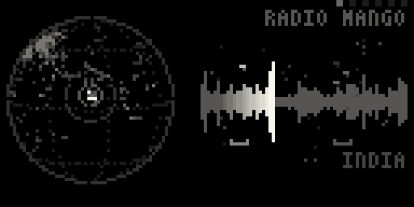

pollen tunes into a live radio station somewhere on Earth, catches it on a reel, a loop of the
last few seconds like a strip of tape, and scatters it as grains: tiny pieces of the broadcast,
played back at their own pitch, length and place. Then the wind carries you on to another
station, near or far, and the grains drift from one place to the next.

Pollen grains and radio waves both cross the planet through the sky, invisibly, and land far
from where they started. You don't pick stations from a list. You choose how the wind blows,
and you shape what it brings.

It's built for listening as much as playing. Leave the wind still and stay with one station, or
give it a pace and let it wander the globe on its own while the reel turns every voice, song
and jingle into texture.

---

## Contents

- [pollen](#pollen)
  - [Contents](#contents)
  - [Foreword](#foreword)
  - [What you need](#what-you-need)
    - [Installing mpv and socat](#installing-mpv-and-socat)
    - [Removing them](#removing-them)
  - [The first minutes](#the-first-minutes)
  - [Playing it](#playing-it)
    - [Choosing a part](#choosing-a-part)
    - [Shaping it](#shaping-it)
    - [Varieties (hold K2 + E2)](#varieties-hold-k2--e2)
    - [Gestures (K3)](#gestures-k3)
    - [Peeking (hold K1)](#peeking-hold-k1)
    - [Going back (hold K1 + K2)](#going-back-hold-k1--k2)
  - [The six parts](#the-six-parts)
      - [wind](#wind)
      - [catch](#catch)
      - [scatter](#scatter)
      - [tint](#tint)
      - [tone](#tone)
      - [air](#air)
  - [The screen](#the-screen)
  - [The wind, in more detail](#the-wind-in-more-detail)
  - [The radio's settings](#the-radios-settings)
  - [Saving what you like](#saving-what-you-like)
  - [A few places to start](#a-few-places-to-start)
  - [If something seems wrong](#if-something-seems-wrong)
  - [Appendix: how it works](#appendix-how-it-works)
    - [The signal path](#the-signal-path)
    - [Where the stations come from](#where-the-stations-come-from)
    - [In a browser](#in-a-browser)
  - [Credits](#credits)

---

## Foreword

Pollen was born from the idea of capturing the aleatory nature of radio stations and all the variety
that exists in the thousands of radio stations scattered across the globe and treating them as
textures for generative music.

The name "pollen" reflects the way the system spreads audio material across grain-like units, scattering it to create evolving textures. It's very much in the regular spirit of glassgarden<span style='color: #d9a441;'>.</span>
creations where nature's patterns and processes inspire the design and behavior of the system.

The initial idea was to capture radios from [radio garden](https://radio.garden), a web platform that lets you explore live radio stations around the world but their audio streams are not accessible via API.

Pollen mixes a source of almost random audio with granular synthesis treatment and some effects in the
chain creating a rich and evolving sonic texture.

Hope you enjoy exploring the sonic textures that pollen creates.

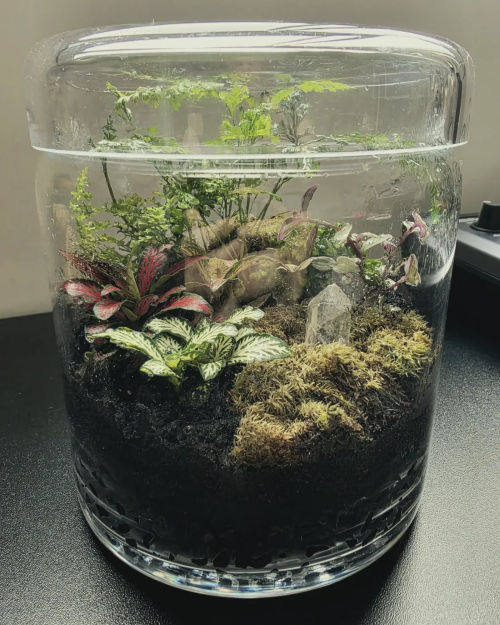

Happy patching!\
Carlos E.\
Founder and creator of glassgarden<span style='color: #d9a441;'>.</span> / Voltage Foundry Modular

## What you need

- A **norns** (any kind: the original, shield, or fates), **on the internet**: the stations are
  live.
- **mpv** and **socat** on the norns, the programs that play the stations. pollen offers to
  install them the first time you open it: one press of K3.
- Optional: the **mi-UGens**, the Mutable Instruments sound modules for norns. With them, the
  reverb is MiVerb, the reverb from Clouds and Rings; without them, a plainer one stands in.
  pollen doesn't ask for them: **PARAMS > air > install mi-UGens** installs them (it needs
  Wi-Fi), and K3 then restarts norns to load them. **remove mi-UGens**, next to it, takes away
  what pollen installed (a set that was already there, from terrarium say, is left alone).

To install pollen, type this in the maiden REPL:

```
;install https://github.com/glassgarden/pollen
```

You can also play with pollen on the web at <https://pollen.glassgarden.cc>

### Installing mpv and socat

The first time you open pollen, it checks for them. If they're missing, a screen lists them with
their sizes (mpv is the big one: it brings its sound libraries along):

- **K3** installs both. It takes a few minutes, with a progress bar; the norns needs to be on the
  internet. When it's done, pollen starts again, with the radio.
- **K2** is "not now": pollen plays without the radio, scattering whatever comes into the norns
  input instead, and the screen says what's missing. It asks again the next time you open it,
  or straight away from **PARAMS > radio > install mpv and socat**.
- **E2** moves through the list to say what each one is for.

If the screen can't install them itself (it needs the norns' usual passwordless `sudo`), it shows
the command to type instead. From a computer on the same network:

```
ssh we@norns.local
sudo apt install -y --no-install-recommends mpv socat
```

(the password is the one you set for the norns, `sleep` if you never changed it).

### Removing them

pollen keeps a note of what it installed, so it can take exactly that away again:
**PARAMS > radio > remove mpv and socat** shows what it will remove, and K3 removes it. Do this
before you delete pollen if you don't want them anymore: deleting a script doesn't run any of
its code. If mpv or socat was already on your norns before pollen, it's left alone, since
another script may use it.

Removing mpv leaves the libraries it brought along. To take those away too, over ssh:

```
sudo apt autoremove
```

That removes every package nothing needs anymore, so read its list before you say yes.

---

## The first minutes

Open pollen from the norns menu (**SELECT > pollen**). The first time, it fetches the list of
stations, the 1,500 most listened-to ones that say where in the world they are, which takes a few
seconds. After that the list is kept on the norns and refreshed once a week.

Then pollen tunes into its first station. On the left of the screen, the globe turns to it; on the
right, the reel starts filling, drawn as a strip of tape. As you arrive, the station's name and
where it is show for a moment.

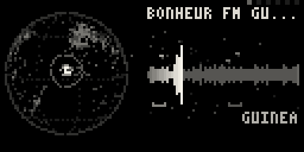

What you hear is a mix of the station as it plays and the grains scattered from the reel.
When you want to move on, choose **wind** with E1 and
press **K3**: the wind carries you to the next station.

The wind starts still, so pollen stays with a station until you drift. Give it a **pace** and it
moves on by itself.

---

## Playing it

pollen has **six parts**: wind, catch, scatter, tint, tone and air. You pick a part, then shape it.

| control      | does                                                               |
| ------------ | ------------------------------------------------------------------ |
| E1           | choose a part: wind, catch, scatter, tint, tone, air               |
| E2, E3       | that part's two knobs (its macros)                                 |
| K3           | that part's gesture (drift, press, burst, flip, fade, haze)        |
| hold K2 + E2 | that part's variety (which wind, how long a reel, which envelope…) |
| hold K2 + E3 | the heads: how many (catch), how far apart in pitch (tint)         |
| hold K1      | peek at every part and the station                                 |
| hold K1 + K2 | back to the station before                                         |

K1 works only when held: a quick tap of K1 opens the norns menu, as in every script.

### Choosing a part

Turn **E1**. The part's name shows at the top left for a moment. Along the top right, a small
square for each part, in E1's order, shows which one you're on: its square is the bright one.
Left alone for a minute, the squares fade out (the screen is an OLED, and nothing should stay lit
for hours); touch anything and they're back.

### Shaping it

**E2** and **E3** are the part's two knobs. Their names and a bar for where each one is show at
the bottom while you turn them: E2's on the left, E3's on the right, where the knobs are on your
norns.

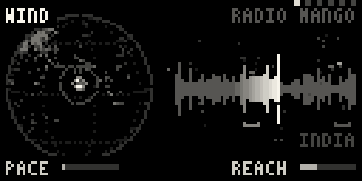

### Varieties (hold K2 + E2)

Each part has a variety: a choice of kind rather than an amount. Hold **K2** and turn **E2**, and
its name shows at the top right.

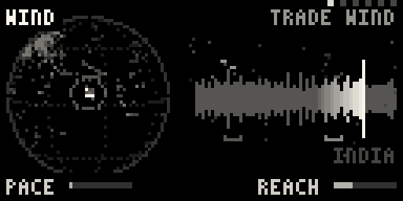

### Gestures (K3)

**K3** does something right away. Some gestures are moments (a burst of grains, a fade, a drift);
others hold until you press K3 again (pressing the reel, flipping the grains, holding the haze).
A word on the screen says which.

### Peeking (hold K1)

Hold **K1** to see every part at once, with a bar for each of its two knobs, and the station
you're on at the bottom. Let go to come back.

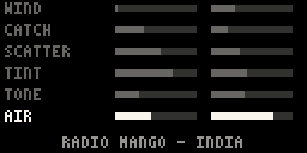

### Going back (hold K1 + K2)

Hold **K1** and press **K2** to return to the station before. Do it again to go further back:
pollen remembers the last 32 places the wind took you.

---

## The six parts

#### wind


When and where the radio moves to the next station.

- **E2 pace**: how often it moves and selects a new station on by itself. All the
  way left (where it starts) it moves only when you drift; then every 10, 5, 2 or 1 minutes,
  or every 30 seconds.
- **E3 reach**: how far a move goes. Left stays close, a city or two away (about 50 km); right
  crosses oceans and continents (up to 10,000 km).
- **K3 drift**: move on to the next station now.
- **Variety, the wind**: _breeze_, _trade wind_, _eddy_, _gust_ or _far side_ (see
  [The wind, in more detail](#the-wind-in-more-detail)).

#### catch

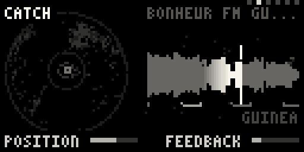

The reel: the loop of tape the radio is recorded onto, and the grains are read from.

- **E2 position**: where on the reel the grains are read. Left is just behind the recording, so
  you hear the station almost live; right reaches back into what was caught seconds ago, and the
  grains come from a wider stretch of it.
- **E3 feedback**: how much of the grains is recorded back onto the reel along with the radio.
  Left, the reel holds only the radio; right, the grains pile up on themselves into smears and
  drones.
- **K3 press**: stop recording, so the reel holds what it has and the grains keep playing it.
  Press again to release it. The station plays on underneath; the reel just stops listening.
- **Variety, reel length**: 4, 8, 15, 30 or 60 seconds of tape (it starts at 15). A new length
  starts an empty reel.
- **Hold K2 + E3, heads**: how many places on the reel the grains are read from, 1 to 4. The
  heads sit evenly spread along the reel behind the first (which position moves), so you hear
  the station now and seconds ago at once. Each has its bracket under the tape.

#### scatter

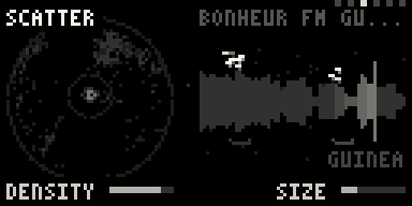

The grains themselves.

- **E2 density**: how many: from one every two seconds to 40 a second. The more there are, the
  looser they fall in time and the wider they spread in stereo.
- **E3 size**: how long each one is: from 20 ms, a click or a buzz, to 2 s, a long overlapping
  wash.
- **K3 burst**: four times as many grains, for a moment.
- **Variety, envelope**: the shape of each grain. _Bell_ is smooth, _pluck_ starts sharp and
  dies away, _block_ is square and clicky.

#### tint

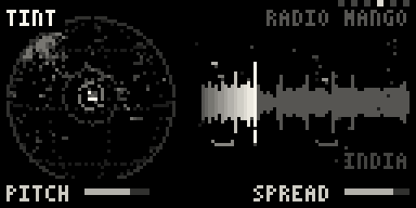

The pitch of the grains.

- **E2 pitch**: from two octaves down (left) to two up (right). The middle plays them as
  recorded. It snaps to the notes of the scale.
- **E3 spread**: how far each grain's pitch wanders from that, up to an octave. Past the middle,
  some grains also play backwards.
- **K3 flip**: most grains play backwards. Press again to turn them around.
- **Variety, scale**: _octaves_, _fifths_ (where it starts), _major_, _minor_, _chromatic_, or
  _free_ (no snapping).
- **Hold K2 + E3, heads apart**: with more than one head, each plays the next note of the scale
  up from the one before it: in _unison_, or _one to four steps_ of the scale apart. In major
  or minor that's a chord. In free, the steps are semitones. Nothing goes more than two octaves
  above the first head.

#### tone

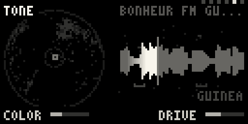

The color of the sound.

- **E2 color**: one filter knob, like a DJ mixer's. The middle is open. Turn left and a low-pass
  closes, darker and muffled; turn right and a high-pass opens, thinner. It rings more toward
  either end.
- **E3 drive**: saturation, from clean to crunchy.
- **K3 fade**: like a shortwave signal fading: for a moment the sound sinks and darkens, then
  comes back.
- **Variety, media**: what the sound passes through, after Mutable Instruments Beads: _digital_
  (clean), _vintage_ (a lo-fi sampler), _clean tape_, _dirty tape_.

#### air

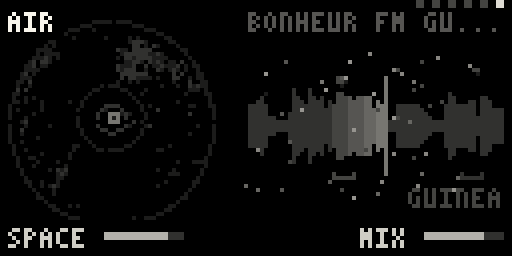

The space around it, and the final mix.

- **E2 space**: how much of the grains goes to the reverb, and how big the room is.
- **E3 mix**: left is the radio alone, as it plays; right is the grains alone; between them,
  both. It starts mostly grains, with some of the station underneath.
- **K3 haze**: hold the reverb's tail so it hangs in the air. Press again to let it go.

---

## The screen

pollen shows pictures, not numbers. The screen has two halves.


**On the left, the globe.** Every station is a dot, so the dots draw the places people broadcast
from. The station you're on is at the middle, sending out radio waves as loud as it is. The
wind's last few moves are its trail. While tuning, the station being tried blinks at the end of
a dotted path and the globe turns toward it.

**On the right, the reel, laid flat like tape.** The waveform is what it caught, with the write
head sweeping across it: the newest sound is brightest just behind the head, and what isn't
caught yet is a dotted line. The bracket under the tape is where the grains are read from (the
catch's position); with more heads, there's a bracket for each. The grains leave the tape from
there, upward when they play forwards and downward when backwards, faster the higher they're
pitched. Silence throws none. Pressed, the head stops and the whole tape holds evenly lit. The
haze over it is the reverb.

**Each part has its piece of the picture.** When you pick a part or turn its knobs, its piece
lights up and the rest dims for a moment, so you can see what you're changing:

- **wind** lights the globe, and draws a dotted ring around the station as far as a move can
  reach. While the wind has a pace, faint streaks drift across the globe, quicker the shorter
  the pace.
- **catch** lights the tape, the head and the brackets.
- **scatter** lights the grains.
- **tint** lights the grains too, and shows the scale as ticks down the right edge (two octaves
  either way, the root brighter), with a mark where the grains are pitched. Free is a faint
  line.
- **tone** lights the waveform.
- **air** lights the haze. The mix also leans the picture: toward the radio, the station's waves
  on the globe grow brighter; toward the grains, the grains do.

The station's name and place show as you arrive, and on a peek.

---

## The wind, in more detail

The wind decides where the next station is. Its variety picks the kind of wind, and **reach**
sets how far each move goes.

| wind       | moves                                                                 |
| ---------- | --------------------------------------------------------------------- |
| breeze     | hops off in any direction, as far as reach says (where it starts)     |
| trade wind | carries on steadily along one bearing, around the world if you let it |
| eddy       | a random walk: the bearing turns a little with each move              |
| gust       | anywhere at all: a country at random, then a station in it            |
| far side   | to the other side of the world, and back                              |

A move always lands somewhere: if it would end out at sea, it takes the nearest station far
enough along, not one back on the coast it left. Stations already visited are skipped until
every one has been heard.

**How a new station comes in.** While the next station loads, the last one keeps playing. Once
it's really playing, the two crossfade over one pass of the reel, so the head writes the new
station over the old a little more each moment and the grains travel from one place to the
other. A station that doesn't play in time is skipped, and the wind tries another.

---

## The radio's settings

In the norns menu (a quick tap of K1), **PARAMS** has every knob, variety and gesture, grouped by
part, so they save with presets and can be mapped to MIDI. Two more groups are about the radio
and the levels:

**radio**

- **handover**: how a new station comes in. _over the reel_ (where it starts) blends it in over
  one pass of the reel; _pressed_ presses the reel while the station loads, then crossfades
  quickly.
- **static while tuning**: some shortwave hiss while the wind is moving you (off to start).
- **crossfade (pressed)**: how long the crossfade takes with the pressed handover.
- **give a station**: how long a station has to start playing before it's skipped (10 s to
  start).
- **refresh the stations**: fetch the list again now, instead of waiting for the week.
- **install mpv and socat**: the install screen again, if you said "not now" (see
  [Installing mpv and socat](#installing-mpv-and-socat)).
- **remove mpv and socat**: take away what pollen installed (see
  [Removing them](#removing-them)).

**levels**

- **level**: the output.
- **input**: how loud everything coming in is: the radio, and anything plugged into the norns
  input, which is scattered along with it (or instead of it, without the radio).
- **static**: hiss and crackle all the time, as if the signal were weak.
- **clear the reel**: empty the tape.

---

## Saving what you like

pollen picks up where you left off: every setting is kept on the way out and read at the next
start. To keep more than one, use presets: in **PARAMS**, **PSET** is at the top (_save_,
_load_, _delete_). A preset remembers every knob, variety and gesture, and the radio settings.
It doesn't remember the station: the wind takes you somewhere new.

---

## A few places to start

**Slow tourism.** wind: _breeze_, pace at 1 minute, reach low. catch: position a little right.
scatter: density in the middle, size large. air: space high, mix mostly grains. Neighbouring
towns' stations drift into each other.

**Around the world.** wind: _trade wind_, pace at 2 minutes, reach all the way right. tint:
_fifths_, spread low. Every couple of minutes you're a few thousand kilometres further along.

**Shortwave.** tone: color a little left, drive up, media _dirty tape_; press K3 on tone now and
then. PARAMS: static a little up. wind: _gust_.

**A chord from a voice.** catch: heads 3. tint: _major_, heads apart _two steps apart_, spread
low. scatter: size large, envelope _bell_. Find a station with someone talking.

**Freeze a moment.** When something good comes by, press K3 on catch: the reel holds it while
the station plays on. Turn up feedback for drones, then release when you're ready for the radio
again.

---

## If something seems wrong

**The screen says pollen needs mpv and socat.** They aren't installed yet: open
**PARAMS > radio > install mpv and socat**, or see
[Installing mpv and socat](#installing-mpv-and-socat). Until then pollen plays the norns input.

**The install stopped with an error.** The screen shows the end of what went wrong: K3 tries
again, K2 closes. The usual cause is the norns being offline, or apt's package lists being out
of date; over ssh, `sudo apt update` and then try again.

**No stations.** The norns couldn't fetch the list: check its Wi-Fi in the norns menu
(**SYSTEM > WIFI**), then **PARAMS > refresh the stations**. Without a list, pollen plays the
input.

**A station is silent, or the wind keeps moving on.** Some stations are offline, or slow to
start. pollen gives each one a few seconds (**give a station** in PARAMS) and then tries
another. A slow network makes this happen more: give stations longer.

**Nothing changes when I turn a knob.** Check the mix (air, E3): all the way left is the radio
alone, with no grains.

**It's too loud, or clipping.** Lower **level** in PARAMS, or feedback in catch: at its highest
the grains pile up on themselves (a limiter keeps them from going over, but they get dense).

---

## Appendix: how it works

### The signal path

The station plays in **mpv** on the norns, which sends its sound into SuperCollider. There it's
written onto the reel, a loop of 4 to 60 seconds, and up to four heads read grains back from
behind the write head. The grains go through the filter, the drive and the media, then to the
reverb, and are mixed with the station as it plays. A limiter at the end keeps it all under full
scale. Two mpv players take turns, so one can load the next station while the other plays.

### Where the stations come from

The list comes from [radio-browser.info](https://www.radio-browser.info), a community database
of radio stations; pollen keeps the 1,500 most listened-to ones that say where they are. The streams
are the stations' own, played live and never stored.

### In a browser

pollen also runs in a web browser at <https://pollen.glassgarden.cc/>: the same script, with the
engine rebuilt for the web. There, only stations whose servers allow a web page to play them
can be heard (most do). Behind the device, the page shows a field of grain under the sky at the
hour it is where the station plays, with pollen drifting on the wind.

---

## Credits

pollen is made by glassgarden. It's free software under the GNU GPL v3.0.

- Ideas from Émilie Gillet's Mutable Instruments Clouds and Beads (MIT): the media stage follows
  Beads' four. Inspired by Make Noise Morphagene and Endorphin.es Evil Pet.
- The reverb, when installed, is MiVerb from Volker Böhm's
  [mi-UGens](https://github.com/v7b1/mi-UGens).
- The stations come from [radio-browser.info](https://www.radio-browser.info).
- mpv and socat are installed and removed with vehka's
  [norns-deps](https://github.com/vehka/norns-deps) (MIT).
- The browser version runs on [norns-web](https://github.com/carlosedp/norns-web) and
  [wasmoon](https://github.com/ceifa/wasmoon).

Mutable Instruments, Make Noise, Endorphin.es and monome are trademarks of their owners, named
only to say what pollen was inspired by or works with.
